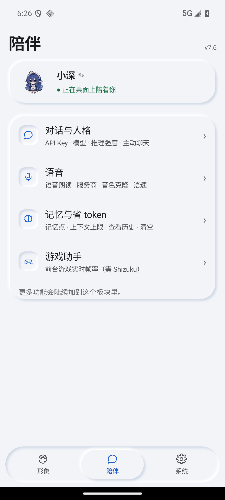
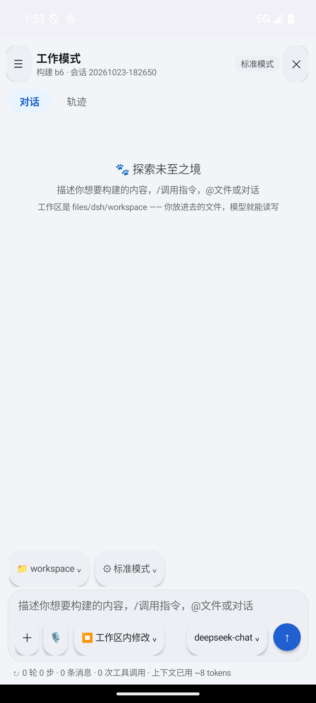
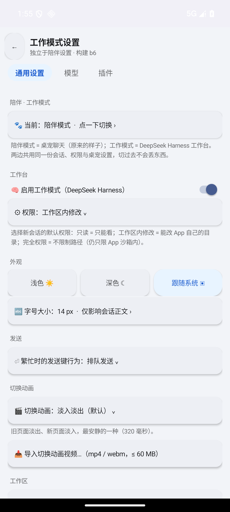

# DeepSeekPet · DeepSeek 桌宠（Android）

一个**纯 Android framework** 写的桌面宠物 App：悬浮桌宠 + 双模式（**陪伴** / **工作**）。

v8.0 的「工作模式」把 **DeepSeek Harness** 本体搬进了手机 —— proot + Ubuntu 根文件系统 + Node 运行时
和上游 harness 包树**全部打在 APK 里**，装完即用，不需要电脑、不需要服务器、不需要额外装第二个 App。

> **非官方声明**：本项目的桌宠美术素材改编自开源项目
> [dsh-pet](https://github.com/PC2005-cloud/dsh-pet)（MIT，© 2026 PC2005-cloud）。
> 本应用是基于该素材**独立开发的 Android 原生实现**，不是 dsh-pet 的官方 Android 版，
> 与该项目的作者不存在隶属、赞助或背书关系。第三方许可全文见
> [`docs/第三方许可声明.md`](docs/第三方许可声明.md)。

---

## 截图

| 陪伴模式 | 工作模式（Harness 本体） | 工作模式设置 |
|---|---|---|
|  |  |  |

---

## 这个 App 能做什么

### 陪伴模式

- **悬浮桌宠**：前台服务常驻，可拖动、贴边吸附、探头、漫游、锁定屏幕时自动收起
- **角色系统**：角色包导入/导出（动作 + 表情）、自定义形象图、App 头像与桌宠形象彻底分开
- **对话**：多家在线服务商 + 自定义 API 地址 + **本地 GGUF 小模型**（可选，本机推理）
- **语音**：离线语音识别（SenseVoice / sherpa-onnx）、TTS、音色、语音朗读归属
- **周边**：余额气泡（可关）、联网检索、天气、定时提醒、游戏助手、点击音效
- **外观**：新拟态 / 玻璃态双引擎、明暗、自定义玻璃配色、视频背景

### 工作模式（= DeepSeek Harness）

- **上游页面 1:1 使用**：不是重画一套 UI，而是把上游 `dsh-web-frontend` 直接跑起来，用 WebView 装上去
- **完全离线**：Ubuntu rootfs、Node、200+ 个 `@deepseek-ai/dsh-*` 包都随 APK 分发
- **工作区在手机存储**：`/sdcard/DeepSeekHarness`，文件管理器里能直接看到
- **固定端口 30800**（保底 30801）：端口不漂 ⇒ 网页里配好的模型 / API Key 不会丢
- **root 可选**（默认关）：开启后宿主以 root 运行，访客内可访问 `/data`、`/system`、`/storage`

---

## 下载

到 [Releases](../../releases) 下载（不要用 `git clone`，仓库里不含大二进制）：

| 包 | 说明 |
|---|---|
| `DeepSeekPet_v8.0_dev.zip` | 开发版，用标准 debug 密钥签名，可直接覆盖安装升级 |
| `DeepSeekPet_v8.0_release.zip` | 正式版，`com.doropet.release`，独立包名可与开发版并存 |
| `DeepSeekPet_v8.0_project.zip` | 完整工程快照（含引擎载荷、模型目录、构建工具链），用于二次开发 |

安装前把 APK 拷到 `/data/local/tmp/` 再 `pm install`（`/sdcard` 是 `noexec`，直接装会被 SELinux 挡）。

**系统要求**：Android 7.0+（minSdk 24）· **arm64-v8a**（只出这一个 ABI）· 首次进工作模式要解 ~800 MB 的 Ubuntu，约 3–8 分钟。

---

## 从源码构建

**不用 Gradle**。自研链路：`aapt2` → `javac` → `d8` → `assemble.py`（控制 `.so` 页对齐）→ `apksigner`。

```bat
set ANDROID_SDK_ROOT=D:\Android\Sdk
python tools\build_win.py
```

构建前还需要两样东西（都不在仓库里）：

1. **`build/toolchain/`**：`android.jar`、`d8.jar`、`apksigner.jar` —— 从 Release 的「项目移植包」里拷
2. **签名库**：
   - 开发版：工程根放一把标准 debug 密钥
     ```bat
     keytool -genkeypair -keystore debug.keystore -alias androiddebugkey ^
       -storepass android -keypass android -keyalg RSA -keysize 2048 -validity 10000 ^
       -dname "CN=Android Debug,O=Android,C=US"
     ```
   - 正式版：`set DSP_VARIANT=release`，再给三个环境变量
     `DSP_KS_PASS` / `DSP_KEY_PASS` / `DSP_KEY_ALIAS`（本仓库**不提供**正式版签名库与口令）

硬约束（都会让断言变红，不是风格建议）：

| 约束 | 原因 |
|---|---|
| **Java 8 语法**、纯 framework、零 androidx / Compose / Material | 目标机型与安装包体积 |
| 所有 `.java` 必须 **LF** 换行 | `verify_character_skeleton` 会查 |
| 禁止 `AlertDialog` / `ProgressDialog`，一律走 `UiFactory` | 深色/玻璃态下弹白底 |
| 界面色值走 `Tokens` 令牌，活代码里不许出现 8 位十六进制色值 | `verify_page_theme` 会查 |

### ⚠️ 仓库里少了三个大载荷

GitHub 单文件上限 100 MB，下面这些**没有**进仓库，缺了它们构建出来的包不会带工作模式：

| 路径 | 大小 | 是什么 |
|---|---|---|
| `assets/engine/harness-linux.tgz` | 118 MB | 上游 harness + 前端产物 |
| `assets/engine/node-linux-arm64.tar.gz` | 54 MB | Node 运行时（arm64） |
| `assets/engine/ubuntu-base.tar.gz` | 28 MB | Ubuntu 根文件系统 |
| `assets/nodelibs/` · `lib/` | 107 MB · 149 MB | Node 的 `.so` 依赖与 JNI 库 |

全部可从 Release 里的 `DeepSeekPet_v8.0_project.zip` 取回，按原路径放回即可。
只做陪伴模式的二次开发则不需要它们。

另外还有 **2 个中等体积的文件**因为发布时上行带宽限制没进仓库
（`deps/kotlin-stdlib-1.9.0.jar` 1.6 MB、`assets/webp/待机呼吸休闲.webp` 2.7 MB），
取法写在 [`docs/两个未入库的大文件.md`](docs/两个未入库的大文件.md)。

---

## 目录结构

```
src/com/deepseek/pet/            162 个 .java（陪伴模式 + DSH 集成）
  ├── dsh/                       Java 内核契约层（会话事件 / 工具 / 策略 / agent loop / 压缩）
  └── dsh/linux/                 proot 引擎：起停、端口、root 回退、载荷解包
res/  gen/  jni/  deps/          资源、R 类、JNI、依赖 jar
assets/                          角色数据、表情动画、引擎载荷（大件见上）
android-plugin/                  harness 侧的 3 个 Android 适配插件（subprocess/sandbox/attachments）
build/                           构建脚本 + 82 套断言（verify_* / reverse_check_*）
docs/                            设计文档、交付说明、构建手册、许可声明、截图
tools/build_win.py               一键构建
```

---

## 质量保证：82 套离线断言

这个工程没有真机 CI，取而代之的是**正向断言 + 反向断言**双轨：

- `build/run_all_tests.bat` —— 一次跑完 **82 套**，末行 `ALL SUITES PASSED` 才算过
- 每套 `verify_xxx.py` 都有配对的 `reverse_check_xxx.py`：**故意把实现改坏，判据必须变红**
  （改坏却不红 = 假绿，等于没测）
- `build/dshtest` / `fpstest` / `cpidtest` 等是**纯 Java 真编真跑**的行为测试，不依赖设备

最近一次全量：`ALL SUITES PASSED（82/82，[FAIL] 0 条，[OK] 4172 条）`。
套件运行期间**不允许改源码**（有快照回滚保护），这条规矩是被事故坑出来的。

---

## 诚实边界（别当成"已经全好了"）

- **root 模式还没在真机跑通全程**：代码有限时授权检测与失败回退，断言与构建都过，
  但真实 `uid=0`、特权目录挂载、root 宿主失败回退仍未经真机实测
- 部分国产 ROM 的后台限制会让首次解包变慢甚至被杀 —— 需要时给 App 开「允许后台运行」
- 上游 harness 自身的功能（模型回答质量、插件生态）不属于本项目范围，随上游版本走
- 工作模式里点「添加附件」需要真机手指验证（本机 `adb` 点击会被合成成 tap）

---

## 许可

- **本仓库代码**：MIT，见 [LICENSE](LICENSE)
- **美术素材 / 第三方组件 / 商标**：见 [`docs/第三方许可声明.md`](docs/第三方许可声明.md)
  （dsh-pet、ex-skill、sherpa-onnx、ONNX Runtime、SenseVoice、Silero VAD、Kotlin stdlib、
  DeepSeek Harness、Node.js、proot（GPL-2.0）、Ubuntu base rootfs）
- **签名密钥不在仓库里**：正式版请自行生成自己的签名库
